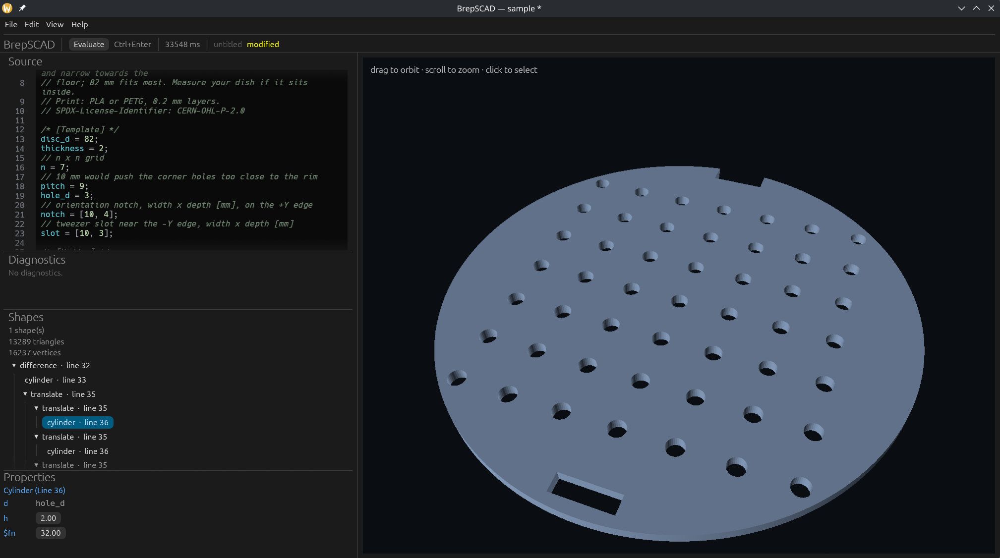

# BrepSCAD

An (extremely) experimental alternative to OpenSCAD, using B-rep geometry rather than OpenSCAD's CGAL/Manifold CSG backends.



BrepSCAD is an independent project and is not affiliated with OpenSCAD.

## Goals

- Keep `.scad` text as the canonical document.
- Allow direct manipulation in the UI, saved back to the source.
- Use B-rep geometry as the canonical representation, rather than mesh tris.
- Export STEP files
- Support multiple kernel backends.
- Implement faster and/or more accurate versions of some common OpenSCAD geometry libraries.
- Render all OpenSCAD source files "close enough" to the original.

## Workspace

```text
crates/
  cli/          CLI entry point (package `brepscad`)
  kernel-api/   Kernel trait, ShapeId, capabilities, neutral mesh
  kernel-truck/ Truck adapter: cuboid, cylinder, sphere, polyhedron, sketch, extrude, revolve
  scad-eval/    evaluator, parameter discovery, 2D profile CSG
  scad-syntax/  lossless CST, lexer, parser, and text edits
  viewer/       egui + wgpu viewer with source editor and orbit camera
vendor/
  truck-shapeops/ patched Truck boolean crate (see vendor/README.md)
```

Additional backend crates (`kernel-occt`, `kernel-solidcore`) are planned for the future.

## Development

A `shell.nix` provides `rustup` and native build essentials: Rust 1.95.0 with clippy, rustfmt, and rust-analyzer.

### Nix / NixOS

```sh
# with direnv:
direnv allow
cargo run -p brepscad
cargo test --workspace

# without direnv:
nix-shell --run 'cargo test --workspace'
nix-shell --run 'cargo run -p brepscad'
```

### Everything else

Same as above, but you must install a Rust toolchain yourself.

## CLI Usage

The CLI currently is mainly for evaluation and debugging. It prints the number
of top-level meshes and the triangle/vertex counts for each mesh:

```sh
# Evaluate a source file.
cargo run -p brepscad -- path/to/model.scad

# Parse without evaluating geometry, for syntax checks and corpus runs.
cargo run -p brepscad -- --parse-only path/to/model.scad

# Add a library directory for angle-bracket include/use paths.
cargo run -p brepscad -- --library-path lib path/to/model.scad

# Use OpenSCAD's origin-at-corner/base-at-zero placement.
cargo run -p brepscad -- --legacy-centering path/to/model.scad
```

Angle-bracket includes also read `OPENSCADPATH` (platform path separator).
Quoted includes resolve relative to the including file only.

When a file path is given, `include` and `use` paths resolve relative to that
file. The built-in sample is evaluated from memory and cannot include files.

By default, BrepSCAD centers cubes and squares, and centers cylinders and
linear extrusions on Z. The legacy flag places cubes/squares at the origin and
cylinder/extrusion bases at `z = 0`.

```text
meshes: 1
mesh 0: 464 triangles, 232 vertices
```

## Language support matrix

Status: ✔ supported, ◐ partial, ✖ not implemented.

| Operation | Status | Notes |
| ----------- | -------- | ------- |
| Top-level assignments | ✔ | |
| Module calls | ✔ | |
| Expressions | ✔ | Arithmetic , comparisons, logic, ranges, ternary , `let`, indexing, dot notation, string indexing, `each`, `undef`, function literals, heterogeneous nested lists, and strings. |
| Comments and whitespace | ✔ | |
| `module` declarations | ✔ | |
| `function` declarations | ✔ | |
| Built-in functions | ◐ | Math/trig and hyperbolic functions, `min`/`max`, `norm`/`cross`/`len`/`concat`, `str`/`chr`/`ord` (`chr` accepts code-point lists), type predicates, `lookup`, `search`, `rands` (`seed_value`), `is_undef`, `is_nan`, `is_function`, `version`, and `version_num`. |
| `for` / `if` | ✔ | `for` supports range/scalar/list/string/undef bindings and `$` loop variables; later bindings can see earlier loop variables. |
| `echo` / `assert` | ✔ | Module and expression forms; assertion failures abort evaluation and `echo` messages are collected. |
| Statement modifiers | ◐ | `*` disables a subtree; `#`, `%`, and `!` are currently parsed but ignored. |
| `let` statement | ✔ | |
| `include` / `use` | ✔ | Angle-bracket paths also search `OPENSCADPATH` and `--library-path` directories. `use` imports declarations from the used file's hidden scope. |
| `$fn`, `$fa`, `$fs` | ◐ | OpenSCAD defaults `$fn=0`, `$fa=12`, `$fs=2`; `PI` is available. `$fn` ≤32 facets; ≥33 or unset uses analytic geometry. `$fa`/`$fs` only sample profiles. |
| `cube`, `cylinder`, `sphere` | ✔ | `cylinder` accepts `h`, `r`/`d`, `r1`/`r2`, `d1`/`d2`, positional `center`, and builds frustums/cones. `sphere` is faceted. |
| `polyhedron` | ✔ | |
| `square`, `circle`, `polygon` | ✔ | `square` accepts `center`; `polygon` accepts `paths` and ignores `convexity`. |
| `translate`, `rotate`, `scale`, `multmatrix`, `mirror`, `resize` | ◐ | `translate` accepts 2D or 3D vectors; `rotate` accepts an angle, Euler vector, or `a=`/`v=` axis-angle; `multmatrix` accepts 3x3, 3x4, 4x3, and 4x4 matrices; `resize` `newsize` only, no `auto`. |
| `linear_extrude` | ◐ | `height`, `center`, `twist`, `scale`, and `slices`; `convexity` is ignored. Multiple 2D children are unioned. Twist/scale require one contour without holes. |
| `rotate_extrude` | ◐ | `angle`, `start`, and ignored `convexity`; profile must lie at `x >= 0`. |
| `difference`, `union`, `intersection` | ◐ | 2D CSG is polygonal; 3D booleans can fail on near-coincident or tangent geometry. Zero-child booleans produce no geometry. |
| `offset` | ✔ | |
| `color` | ◐ | Parsed but ignored; color is not rendered. |
| `render` | ◐ | No effect. |
| `hull`, `minkowski` | ◐ | Convex 3D children; Minkowski uses the convex hull of pairwise vertex sums. |
| `import`, `export`, `surface` | ✖ | No file I/O yet. |
| `projection` | ✖ | |

By default, `cube`, `square`, `cylinder`, and `linear_extrude` use BrepSCAD's
centered placement. The legacy option switches to OpenSCAD's origin-at-corner
and base-at-zero placement.

## Feature matrix

Status: ✔ supported, ◐ partial, ✖ not implemented.

| Feature | Status | Notes |
| --------- | -------- | ------- |
| Source editor | ✔ | In-memory basic textbox. |
| Source tree | ✔ | Groups and selectable leaf primitives. |
| UI parameter editing | ◐ | Numeric parameters only. |
| Background evaluation | ✔ | |
| Preview-based selection | ✔ | |
| 2D profile CSG | ✔ | Via `clipper2-rust`. |
| Alternate kernels | ✖ | Truck only; OCCT and SolidCore are candidates. |
| File open/save | ✔ | Permanent buttons for now |
| Export | ✖ | |
| Undo/redo | ✖ | |
| Persistence | ✖ | |

## GUI

```sh
cargo run -p brepscad-viewer
```

## Documentation

- [`docs/status.md`](docs/status.md) — current capabilities, limitations, and next steps.
- [`docs/development.md`](docs/development.md) — development helpers
- [`docs/research.md`](docs/research.md) — prior art, source-first architecture, kernel trade-offs, native library fast paths.
- [`docs/kernels.md`](docs/kernels.md) — per-operation capability matrix for OCCT, SolidCore, and Truck.

## Licence

Licensed under the BSD 3-Clause license. See [`LICENSE`](LICENSE).

BrepSCAD depends on several third-party libraries. Of note:

- Truck is MIT/Apache-2.0 dual-licensed.
- The vendored `truck-shapeops` crate is Apache-2.0; its license and patch notes are in [`vendor/`](vendor/README.md).
- clipper2-rust is BSL-1.0, the same as Clipper2.

Planned backends:

- OCCT is LGPL-2.1 with an exception; if it is shipped, dynamic linking/relinkable distribution and notice obligations apply.
- SolidCore is Apache-2.0.
